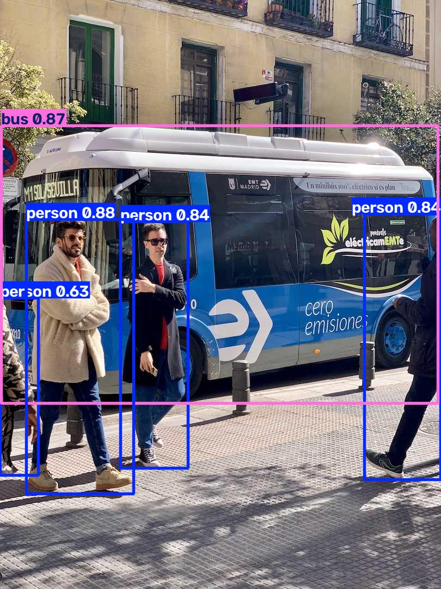

# 🚀 YOLOv5 Object Detection & Analytics Pipeline

> An object detection and analytics pipeline using a pretrained YOLOv5u model.

---

## 🎯 Project Overview

This project implements an object detection and analytics pipeline using **YOLOv5u**, PyTorch, and Ultralytics.

The pipeline performs:

* 🧠 Pretrained object detection
* ⚡ CUDA-accelerated inference
* 🖼️ Batch image processing
* 📦 Bounding-box generation
* 🔢 Class-based object counting
* 📊 Detection analytics
* ⏱️ Inference performance measurement
* 📄 JSON-based result export
* ⚙️ Configurable confidence threshold and image size

---

## 🔄 Pipeline

```text
                Input Images
                     │
                     ▼
             ┌─────────────────┐
             │   YOLOv5u Model │
             └─────────────────┘
                     │
                     ▼
              Object Detection
                     │
            ┌────────┴────────┐
            ▼                 ▼
     Bounding Boxes      Detection Data
            │                 │
            ▼                 ▼
     Annotated Images      Analytics
                              │
                              ▼
                    JSON Result Export
```

---

## ✨ Features

### 🧠 Object Detection

Uses a pretrained **YOLOv5u** model to detect multiple object classes in input images.

### ⚡ CUDA Acceleration

Automatically uses an NVIDIA GPU when CUDA is available and falls back to CPU otherwise.

### 🖼️ Batch Inference

Multiple `.jpg`, `.jpeg`, and `.png` images can be processed in a single execution.

### 📦 Bounding Boxes

Detected objects are visualized with bounding boxes, class labels, and confidence scores.

### 🔢 Object Counting

Detected objects are grouped by class.

Example:

```json
{
    "person": 6,
    "bus": 1,
    "tie": 1
}
```

### 📊 Analytics Export

Detection results are exported to a structured JSON file containing:

* Processing device
* GPU information
* Model name
* Confidence threshold
* Image size
* Number of processed images
* Average inference time
* Per-image object counts
* Average detection confidence
* Model forward-pass time

### ⏱️ Performance Monitoring

The pipeline measures inference latency and reports:

* Total inference time
* Model forward-pass time

CUDA synchronization is used during timing to account for asynchronous GPU execution.

### ⚙️ Configurable Inference

The pipeline supports command-line configuration for:

```text
--input
--output
--conf
--imgsz
--model
```

For example:

```bash
python detect.py --conf 0.25
```

---

## 🛠️ Technologies

| Technology     | Purpose                 |
| -------------- | ----------------------- |
| 🐍 Python      | Application development |
| 🔥 PyTorch     | Deep learning framework |
| 👁️ YOLOv5u    | Object detection        |
| 🧰 Ultralytics | Model inference API     |
| ⚡ CUDA         | GPU acceleration        |
| 🖼️ Pillow     | Image processing        |
| 📄 JSON        | Detection analytics     |

---

## 📁 Project Structure

```text
yolo-object-detection/
│
├── data/                       # Local input images
│   ├── bus.jpg
│   └── zidane.jpg
│
├── outputs/
│   ├── detected_bus.jpg
│   ├── detected_zidane.jpg
│   └── detection_summary.json
│
├── detect.py                   # Main inference pipeline
├── requirements.txt            # Python dependencies
├── README.md
└── .gitignore
```

The pretrained model weights (`yolov5su.pt`) are downloaded automatically when required and excluded from version control.

---

## 🚀 Installation

### 1️⃣ Create a virtual environment

```bash
python -m venv .venv
```

### 2️⃣ Activate the environment

Windows PowerShell:

```powershell
.\.venv\Scripts\activate
```

### 3️⃣ Install PyTorch with CUDA support

For the CUDA-enabled environment used during development:

```bash
pip install torch torchvision --index-url https://download.pytorch.org/whl/cu121
```

### 4️⃣ Install remaining dependencies

```bash
pip install ultralytics pillow
```

---

## ▶️ Usage

Run the pipeline with:

```bash
python detect.py
```

The script:

1. Detects whether CUDA is available.
2. Loads the pretrained YOLOv5u model.
3. Uses sample images when the default input directory is empty.
4. Processes supported images in the input directory.
5. Generates annotated output images.
6. Calculates object counts and confidence statistics.
7. Measures inference performance.
8. Exports the results to JSON.
9. Prints a summary to the terminal.

### 🎚️ Confidence Threshold

The default confidence threshold is:

```text
0.40
```

It can be changed from the command line:

```bash
python detect.py --conf 0.25
```

### 🖼️ Image Size

The default inference image size is:

```text
640
```

It can be changed with:

```bash
python detect.py --imgsz 640
```

---

## 📊 Final Test Results

The pipeline was tested locally using:

```text
Model: YOLOv5u
Confidence threshold: 0.40
Image size: 640
Device: CUDA
GPU: NVIDIA GeForce GTX 1650 Ti
VRAM: 4 GB
```

### Detection Results

| Image        | Objects | Detected Classes |
| ------------ | ------: | ---------------- |
| `bus.jpg`    |       5 | 4 persons, 1 bus |
| `zidane.jpg` |       3 | 2 persons, 1 tie |

### Overall Results

```text
Images processed:       2
Total objects detected: 8

Class counts:
  person: 6
  bus:    1
  tie:    1

Average inference time: 53.48 ms
```

### Per-Image Measurements

```text
bus.jpg
  Objects:             5
  Average confidence:  0.8121
  Total inference:     53.92 ms
  Model forward pass:  44.63 ms

zidane.jpg
  Objects:             3
  Average confidence:  0.8017
  Total inference:     53.04 ms
  Model forward pass:  41.05 ms
```

---

## 📄 Detection Summary

The pipeline generates `outputs/detection_summary.json`.

The report contains:

```json
{
    "device": "cuda",
    "gpu": "NVIDIA GeForce GTX 1650 Ti",
    "model": "yolov5su.pt",
    "confidence_threshold": 0.4,
    "image_size": 640,
    "images_processed": 2,
    "average_inference_time_ms": 53.48
}
```

Per-image results additionally contain object counts, average confidence values, total inference time, and model forward-pass time.

---

## 🖼️ Detection Output

The pipeline generates annotated images containing detected objects, class labels, and confidence scores.



---

## ⚡ Hardware Acceleration

The pipeline automatically selects the available inference device:

```text
CUDA → NVIDIA GPU
CPU  → fallback
```

The local test environment:

```text
GPU: NVIDIA GeForce GTX 1650 Ti
VRAM: 4 GB
```

CUDA was available and used during the final test.

---

## 🔬 Technical Scope

The implementation includes:

* Pretrained YOLOv5u inference
* CUDA/CPU device selection
* Configurable confidence threshold
* Configurable inference image size
* Batch image processing
* Object counting
* Bounding-box visualization
* Detection confidence analysis
* Inference latency measurement
* Structured JSON analytics
* Automatic sample-image handling
* Batch-level error handling

The project uses pretrained model weights and focuses on the inference pipeline and analytics workflow.

---

## 🔮 Possible Extensions

Future versions could include:

* 🎥 Real-time video detection
* 🚗 Object tracking
* 📈 Detection statistics dashboards
* 🌐 REST API inference service
* 🐳 Docker-based deployment
* 🧪 Evaluation on a labeled benchmark dataset
* 🔧 Model optimization for edge devices

---

## 📌 Key Takeaway

The project demonstrates an object detection workflow based on YOLOv5u, including image inference, visualization, object counting, structured analytics, configurable inference parameters, and performance measurement.

It complements the image-classification project by focusing on **object detection and inference pipeline design**.
